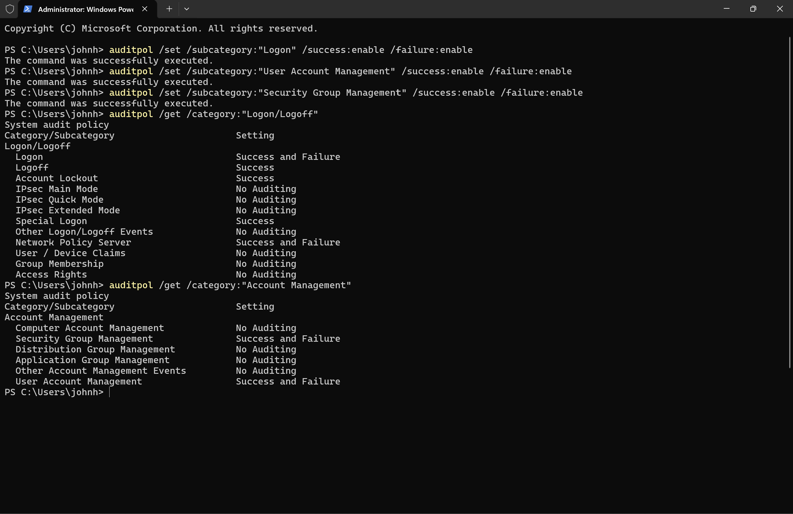
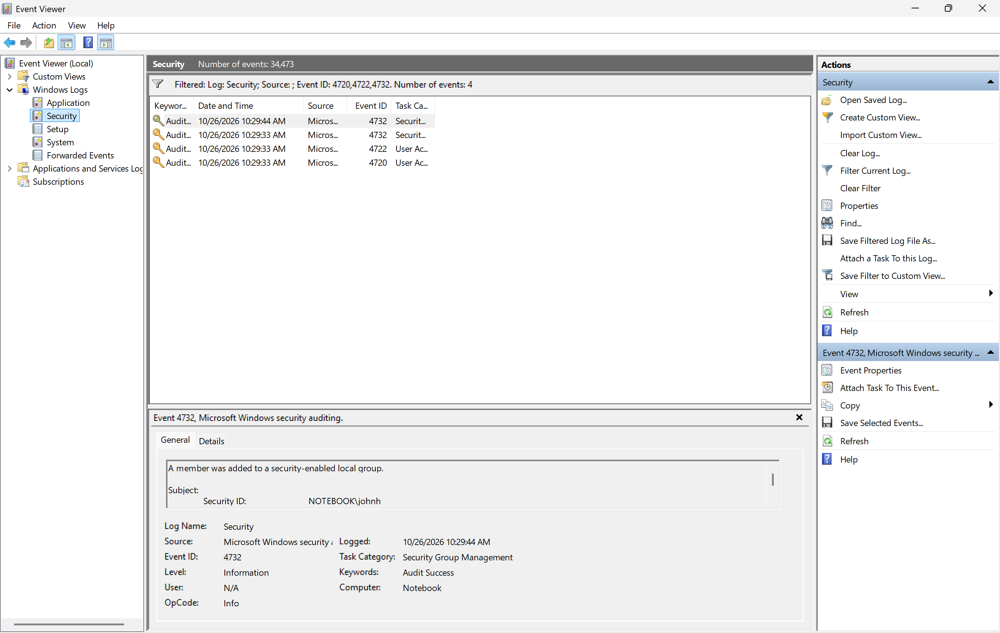
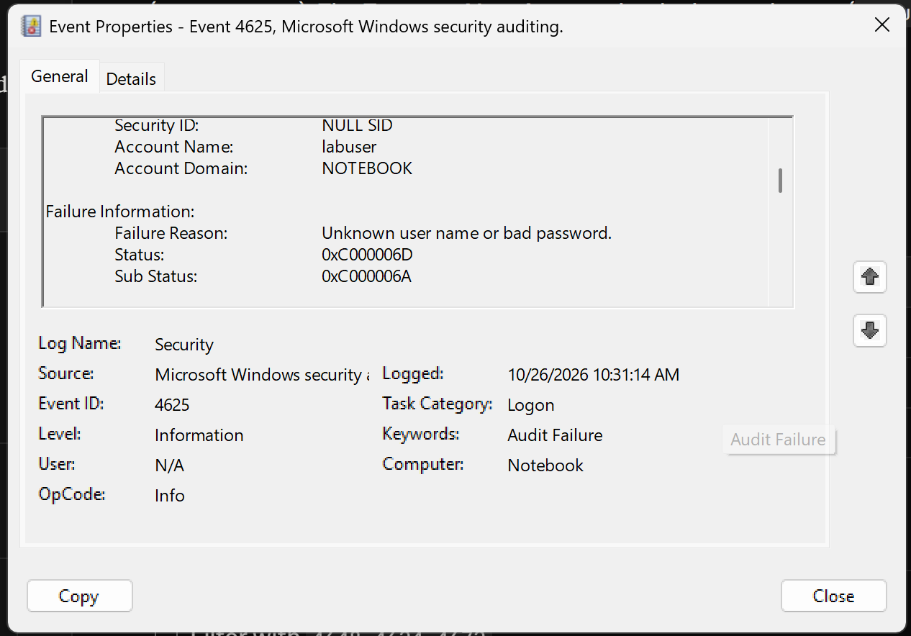
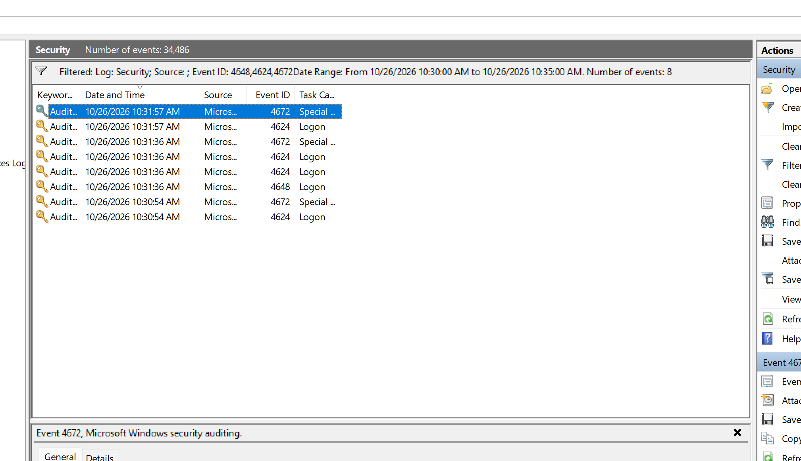

# Windows Event Log Investigation Lab

A hands-on SOC analyst exercise on a Windows 11 laptop. I simulated a small attack on my own machine (creating a backdoor admin account and guessing its password), then switched roles and investigated it using only the Windows Security log.

## What This Lab Shows

- Configuring Windows audit policy with `auditpol`
- Investigating the Security log in Event Viewer using event ID and time-range filters
- Identifying persistence (new account added to Administrators)
- Identifying a password-guessing pattern and a successful compromise
- Separating real signals from background noise (SYSTEM and service logons)
- Writing an incident timeline and summary with recommendations
- Cleaning up, including leftover profile artifacts

## Tools

- Windows 11 (built-in tools only, no downloads)
- `auditpol`, `net user`, `net localgroup`, `runas`
- Event Viewer (`eventvwr.msc`)

## Simulated Attack

| MITRE ATT&CK | Technique | What I did |
| --- | --- | --- |
| T1136.001 | Create Account: Local Account | Created a local account, `labuser` |
| T1098 | Account Manipulation | Added `labuser` to the Administrators group |
| T1110 | Brute Force | 5 failed logins to `labuser`, then a successful one |

## Step 1: Turn On Auditing

Windows only logs what it is told to audit. I enabled success and failure auditing for logons, user account management, and security group management.

```
auditpol /set /subcategory:"Logon" /success:enable /failure:enable
auditpol /set /subcategory:"User Account Management" /success:enable /failure:enable
auditpol /set /subcategory:"Security Group Management" /success:enable /failure:enable
```



## Step 2: Investigate the New Account

Filtering the Security log (34,000+ events) to IDs `4720,4722,4732` narrowed it to 4 events.



**Finding:** there were two 4732 events but only one group command was run. Reading the **Group Name** field showed why: Windows automatically adds every new local account to **Users** at creation (normal), while the second 4732 was the deliberate add to **Administrators** (the red flag). Same event ID, very different meaning.

## Step 3: Investigate the Logins

Filtering to `4625` showed 5 failed logons against `labuser`.



| Field | Value | Meaning |
| --- | --- | --- |
| Account Name | labuser | The targeted account |
| Logon Type | 2 | Attempt made at the keyboard |
| Sub Status | 0xC000006A | Account exists, wrong password |

A Sub Status of `0xC000006A` means the attacker already knew a valid username. `0xC0000064` would mean the username itself was wrong.

Filtering `4648,4624,4672` returned 2,000+ events because of background noise. Narrowing to a 5-minute window around the failures cut it to 8 and exposed the successful login.



The cluster at 10:31:36 confirmed the compromise:

- **4648:** `johnh` used `labuser`'s credentials
- **4624 (x2):** `labuser` logged on (Type 2). Two sessions because admin accounts get a limited and an elevated session under UAC
- **4672:** `labuser` received admin privileges

## Incident Timeline

| Time | Event ID | What happened |
| --- | --- | --- |
| 10:29:33 | 4720 | `johnh` created account `labuser` |
| 10:29:33 | 4722 | `labuser` enabled |
| 10:29:33 | 4732 | `labuser` auto-added to Users (normal) |
| 10:29:44 | 4732 | `johnh` added `labuser` to **Administrators** |
| ~10:31 | 4625 (x5) | 5 failed logons to `labuser`, wrong password |
| 10:31:36 | 4648 | `johnh` used `labuser`'s credentials |
| 10:31:36 | 4624 (x2) | `labuser` logged on successfully |
| 10:31:36 | 4672 | `labuser` granted admin privileges |

## Incident Summary

**What happened:** A new local account, `labuser`, was created and added to the Administrators group about 10 seconds later. Around 10:31 there were 5 failed logins to `labuser` back to back, followed by a successful login with full admin privileges.

**Accounts involved:** `johnh` created the account, added it to Administrators, and typed in `labuser`'s credentials. `labuser` was the targeted account.

**Why it's suspicious:** A new account getting admin rights immediately is a common persistence technique. Five failed logins in under a minute followed by a success is a password-guessing pattern, not a typo. Since `johnh` is tied to every step, that account is either the attacker or compromised.

**Recommendation:** Disable `labuser` and remove it from Administrators. Reset `johnh`'s password, review its recent activity, and confirm with the owner whether they made these changes. Check other machines for the same account or login pattern.

## Cleanup

- Removed `labuser` from Administrators (4733) and deleted the account (4726)
- Deleted the leftover `labuser` profile through System Properties > User Profiles
- Left auditing enabled

## Lessons Learned

- **Read the fields, not just the event ID.** Both 4732s looked identical until the Group Name was checked.
- **Confirm, don't assume.** A 4624 + 4672 pair I expected to be my admin terminal turned out to be a SYSTEM service logon (Type 5).
- **Pivot on time to cut noise.** A 5-minute window took 2,066 events down to 8.
- **Regular timing is worth noticing.** Logons every 15 minutes like clockwork pointed to a scheduled task. Here it was benign, but the same pattern is how malware beaconing looks.

## Event ID Reference

| Event ID | Meaning |
| --- | --- |
| 4624 | Successful logon |
| 4625 | Failed logon |
| 4648 | Logon with explicit credentials |
| 4672 | Special (admin) privileges assigned |
| 4719 | Audit policy changed |
| 4720 | User account created |
| 4722 | User account enabled |
| 4726 | User account deleted |
| 4732 | Member added to local group |
| 4733 | Member removed from local group |
